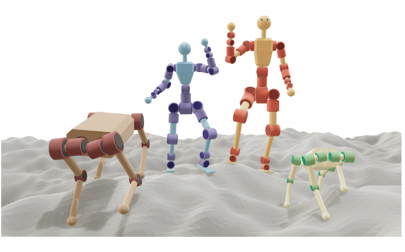
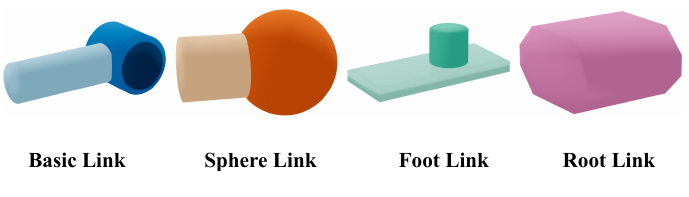
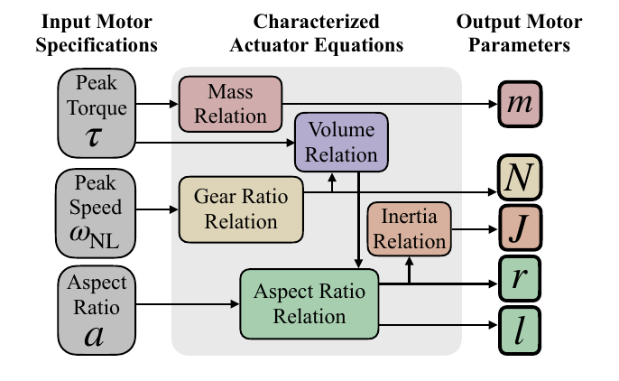
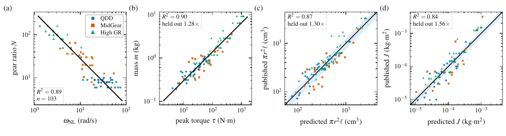
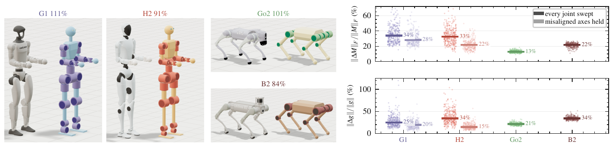
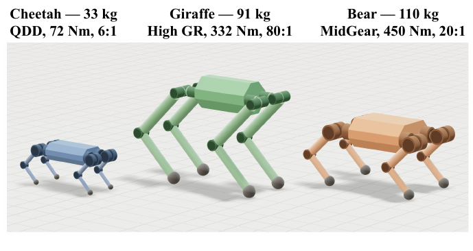
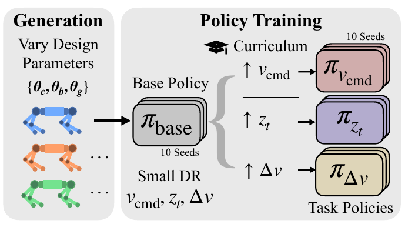
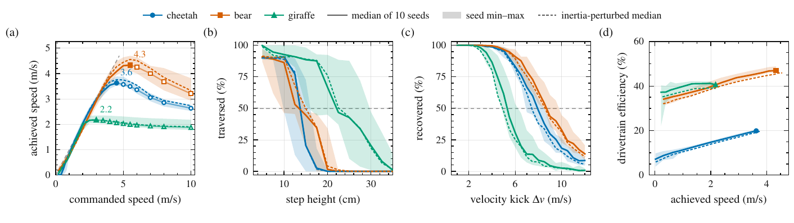

# Draft：面向机器人设计探索的参数化工具

David Nguyen¹，Marcelo Coelho²，Sangbae Kim¹

¹ 麻省理工学院机械工程系　² 麻省理工学院建筑系

原文：Draft: A Parametric Tool for Robot Design Exploration

版本：arXiv:2609.38405v1 [cs.RO]，2026 年 9 月 29 日

中文全文译本｜译制日期：2026 年 10 月 22 日

> 译本说明：本译本依据用户提供的原始 PDF 制作，包含全文正文、公式、8 幅原图、6 张中文重排表格以及 30 条参考文献。原图内英文保留，并提供中文标签对照；参考文献保留作者和出版信息，题名附中文翻译。正文中的“我们”均指原论文作者；译文不增加论文没有提出的结论。此为非官方中文译本，原图和原文著作权归原权利人所有。

## 摘要

机器人的性能往往受到形态与控制协同迭代成本的限制：每次计算机辅助设计（CAD）的修改，都必须先转化为可用于仿真的模型，控制方面的工作才能开始。协同设计方法试图弥合这一缺口，但这些方法要么使用针对单一平台编写的模型生成器，要么缺少真实世界数据来支撑设计的合理性。我们提出 Draft，一种参数化生成工具。其通用引擎无需 CAD，即可将由串联运动链组成的任意参数化树编译成可直接用于仿真的 MJCF 模型。工程师可以借助易于调整的模型探索设计权衡，并评估修改对控制器性能的影响。Draft 对 114 个执行器和 49 份已公开机器人描述进行调查，拟合其变化规律，为每项设计的自由参数提供依据，使生成的机器人模型以真实硬件为基础。我们通过构建四款现成机器人的孪生模型，对这些规律进行整体验证；模型质量与原机器人质量之间的几何平均倍数误差为 1.10×。最后，我们使用两阶段强化学习课程评估三种四足机器人，展示 Draft 如何揭示设计中的性能权衡。

图 1　Draft 根据少量规格参数，生成中等保真度的机器人模型，并将其编译为可直接仿真的 MJCF 模型。一个参数的修改会传递到视觉、碰撞、惯性以及驱动属性。

## I. 引言

控制与硬件设计的集成进展缓慢，因为计算机辅助设计（CAD）和仿真器使用的机器人描述文件之间缺少一个中间层。工程师建立 CAD 装配体，导出机器人描述，再交给控制工程师；后者构建控制器并反馈结果。每轮迭代都要等待 CAD 导出和一次训练，因此通常只能进行少数几轮。腿长、执行器安装位置等决定机器性能上限的选择，因而在信息不足时就过早确定下来。其后果直到后续才显现：机器人达到自身极限，控制器表现不佳。

协同设计直接处理这一问题，将设计参数与控制一起优化 [1]、[2]、[3]。不同方法或将两者联合求解，或采用内外层循环。尽管具有协同设计结构，其模型生成过程通常仍针对某个特定平台，限制了通用性。模型生成往往也考虑硬件约束，但考虑得比较宽泛，例如仅用少数电机拟合电机质量规律，并给整个结构指定一个统一密度 [4]、[5]、[3]。工程师在硬件设计中遇到的实际约束，在这些协同设计策略中大多缺位，因此很难据此判断一个机器人模型是否能够制造出来。

我们提出 Draft：一种参数化生成工具，利用参数有真实数据支撑的中等保真度机器人模型，实现快速设计探索（图 1）。在 Draft 中，机器人由一个参数文件和一棵运动学树描述，生成器将其编译为 MuJoCo MJCF [6] 模型；模型由基本几何体以及通过放样构建的根部网格组成。这样就省去了从 CAD 转换到仿真的步骤，可以在毫秒级时间内生成一系列在减速比、连杆长度和执行器选择上不同的设计。

我们的贡献如下：

1. 一个通用 MJCF 生成器。它通过自身的构建方式，使每项尺寸与执行器选择自然传递到视觉、碰撞和惯性属性；我们以人形和四足机器人作为示例模型。
2. 对 114 个一体化执行器和 49 份公开机器人描述的调查，以及从中拟合出的规律，为设计自由参数提供合理取值。我们通过重建四款现成平台，对整个流程进行端到端验证。
3. 展示生成模型具有可测量的性能权衡。三种在尺度、站姿、腿长和执行器选择上不同的四足机器人，在同一学习环境中表现出可测量的能力差异。

## II. 相关工作

### A. 协同设计流程

参数化模型生成很少被单独研究；它通常包含在协同设计流程中，其实现也受到该流程的影响。模型生成是围绕协同设计优化器定制的，而不是面向需要将输出转化为可制造机器人的工程师。现有策略各有局限。Ghansah 等人将设计参数作为额外关节加入固定运动学树，使连杆长度和惯量能够变化，而无需重新构建模型 [7]。把模型参数纳入符号动力学函数，可以自然地与传统最优控制结合，但与强化学习的直接兼容性较弱 [1]、[2]、[3]。Vanteddu 等人驱动一个参数化 CAD 主模型，获得了现有方法中很高的保真度；但其重新生成速度慢，大幅修改时容易出问题，面对新机器人还需要重新开始 [8]。Xu 等人的基础网格变形方法适合接触丰富的机械臂设计，但其处理的是表面细节，而非早期设计中起主导作用的较大尺度结构变化 [9]。Gupta 等人和 Yuan 等人都用简单的胶囊体与圆柱体生成机体，但优化的是形态，而非细节完整的机器人 [10]、[11]、[12]。Zhao 等人的 RoboGrammar 同样通过连杆基本单元体现模块化思想，但没有详细评估生成设计的制造可行性 [13]。

Draft 希望通过结合生成器与评估器来应对这些局限，但它并不是一个完整的协同设计闭环。我们没有纳入设计优化器，而是让工程师自行迭代，以便兼顾其复杂的设计约束。

用于评估的控制器选择，对生成器的限制不亚于外层循环。轨迹优化占据主流，因为符号模型可以很好地与最优控制结合；但它返回的是开环规划，而不是闭环控制器 [3]、[14]、[15]。强化学习直接解决这一局限，因为它返回的是策略而非规划，因此可以在评估能力的同时评估可控性 [16]、[17]。其限制在于，难以大规模生成真实可信、可以直接用于学习的模型。Draft 正是为解决这一问题而设计的。

### B. 执行器与结构的缩放规律

我们选择拟合专门的参数方程，而不是直接采用现有规律，因为机器人执行器具有特殊性，且其缩放关系的研究仍然较少。以往工作关注直驱电机或单独的减速器，没有覆盖机器人中普遍使用的一体化模组。Dermitzakis 等人对爱好者级舵机进行回归分析，Rodriguez 等人研究了跨越七十年的电机数据，但两者都没有纳入减速器 [18]、[19]。Saerens 等人研究传动机构，却将其与电机规律分开，因而没有考虑二者固有的耦合 [20]。从一种拟合关系中选出的电机与另一种拟合关系中选出的减速器，未必总能组成可行的模组。Honsinger 的尺寸关系 τ = 2πσr2ℓ，以及建立在它之上的执行器设计规则，将几何参数转化为电机本体的力矩，但同样没有包含减速器 [21]、[22]、[23]。协同设计继承了这些建模局限，重复使用从少量无框电机拟合出的近似等比例缩放规律 [4]、[5]。

机器人结构的变化规律研究得更少。Oke 等人拟合了双足机器人的异速生长规律 [24]，但整机尺度的规律不能覆盖单个连杆，这限制了对拟合分布之外机器人设计的预测精度。我们分别为各类机器人连杆拟合方程，并将每个连杆的质量分为执行器与结构两部分，以进一步提高模型保真度。

## III. 参数化模型生成

### A. 机器人规格描述

在我们的表述中，一个机器人由三个文件定义。第一个是参数文件，指定连杆长度、密度、电机类别等数值。第二个是运动学树，其字段为引用参数文件中数值的算术表达式。第三个描述根部机体的网格。由于树中保存的是表达式而非固定数字，因此可以通过编写关系来减少需要单独指定的参数。例如，肢体半径可以与驱动它的电机关联，而不必手工指定。

读取这些文件的生成器本身不预设机体构型。人形、四足以及其他关节式机器人都使用相同的生成代码，因此新的机器人形态很容易编译和迭代。此外，编译成本足够低，允许对设计参数进行大范围扫描。在笔记本电脑 CPU 上，29 关节人形机器人编译成通过验证的 MJCF 需要 202 ms，12 关节四足机器人仅需 50 ms。

我们选择输出 MJCF 而不是 URDF，因为 MJCF 可以直接声明关节折算惯量（armature）和减速比等执行器参数，并自动计算惯性属性。

图 2　所有生成的 Draft 模型都由四种主要连杆基本单元构成。基本连杆包含连杆本体及位于其远端的电机；球形连杆用一个接触点终止关节链；足部连杆以支撑面实现相同作用；根部连杆包含自定义几何体，供肢体从其上延伸。

图内标签对照：Basic Link＝基本连杆；Sphere Link＝球形连杆；Foot Link＝足部连杆；Root Link＝根部连杆。

### B. 连杆基本单元与驱动

肢体由四种连杆基本单元组装而成（图 2），每种单元承担一种功能。基本连杆是一个结构圆柱体，在远端装有驱动子关节的电机；将这些单元连接起来，即可构成串联关节肢体。球形连杆以接触点结束运动链。足板则以一个表面结束运动链，使接触位置覆盖一个支撑多边形。根部连杆为肢体布置提供最大的几何自由度，因此使用网格生成。它由截面多边形及其所在平面定义，通过放样形成封闭网格。该网格始终与同一组符号参数关联，因此肩宽的变化也会传递到网格。

由基本几何体生成的连杆，其惯性属性通过 MuJoCo 内置的 inertiafromgeom 计算。它根据连杆几何和输入密度计算质量与惯性张量，省去了在生成器中直接指定惯量的需要。根部连杆的惯性数值由 trimesh [25] 提供。连杆质量、电机类别以及根部网格密度的拟合见第 IV 节。

每个关节通过峰值力矩 τpeak 和空载转速 ωNL 指定，并在第 V 节的学习环境中建模。每个关节通过直流电机模型驱动，该模型将执行器限制在线性扭矩—转速曲线内。关节增益遵循人工调整的比例关系：kp = 1.43 τpeak，kd = 0.071 τpeak。因此，对各个关节而言，相同的跟踪误差会请求相同比例的可用力矩。

连杆库通过固定关节类型支持执行器远置，但不支持并联机构。例如，我们的四足机器人将膝关节电机放置在髋部；通过组合两个模块，在不增加自由度的情况下构成复杂连杆，实现这种布置。

## IV. 将模型参数拟合到真实硬件

生成器保证模型内部自洽，却不保证设计本身合理。第 III 节的方法并没有阻止参数扫描提出一种执行器，其力矩密度达到市场上任何现有产品的两倍；这样就可能报告实际上无法实现的硬件性能。因此，我们对真实硬件调查数据拟合方程，并将其整合回生成流程，作为约束边界。我们分别调查执行器与机器人结构。

所有执行器拟合都采用相同的评分方式，即留一法（LOO）验证。我们依次留出每条记录，用其余记录重新拟合，再预测被留出的记录，并报告 n 条记录上的几何平均倍数误差：

$$ GMFE = exp[(1/n) ∑i=1n |ln(ŷi/yi)|]。　(1)

其中，ŷi 是对留出样本的预测值，yi 是公开的真实数值。因此，GMFE 表示预测在高估或低估两个方向上的典型偏离倍数。1.10× 的倍数误差表示，在未参与拟合的数据上，典型偏差约为 10%。

### A. 执行器数据集

我们收集了 114 条旋转执行器记录，其中 111 条来自 11 家厂商，另有 3 个研究型执行器来自公开论文。对每条记录，我们收集峰值输出力矩 τpeak、空载输出转速 ωNL、减速比 N、模组质量 m、外形尺寸以及转子惯量 J。每条记录都对应一体化模组，即电机、传动机构、轴承和外壳集成在同一个封装中。我们按传动形式将其分为 QDD（准直驱，减速比 6–10）、MidGear（一体化行星传动，减速比 7–64）和 High GR（高减速比，多为应变波传动，减速比 50–161）。目录包含 33 个 QDD、33 个 MidGear 和 48 个 High GR 模组，覆盖 2.5–1180 N·m 的力矩范围，以及 0.19–9.3 kg 的质量范围。

这一执行器样本集合不包含尚未集成为完整执行器的高性能转子—定子组合，因此未能覆盖性能优于我们拟合关系的定制设计。所以，我们的方程可以视为基准下限而非性能上限，并作为一个有依据的基线。

图 3　执行器参数由数据支持的关系推导而来。输入是峰值力矩 τ、空载转速 ωNL 和长径比 a。质量 m 由 τ 估计，减速比 N 由 ωNL 估计。体积 V 根据 τ 和 N 估计，再与 a 一起确定半径 r 和长度 ℓ。最后，由 r 推导转子惯量 J。

图内标签对照：Input Motor Specifications＝输入电机规格；Characterized Actuator Equations＝拟合得到的执行器方程；Output Motor Parameters＝输出电机参数；Peak Torque＝峰值力矩；Peak Speed＝峰值转速（图注及正文中的输入为“空载转速”）；Aspect Ratio＝长径比；Mass / Gear Ratio / Volume / Aspect Ratio / Inertia Relation＝质量／减速比／体积／长径比／惯量关系。

表 I　按流程顺序列出的拟合关系，以及留一法验证的倍数误差。

| 参数 | 拟合值 | n | R2 | LOO |
| --- | --- | --- | --- | --- |
| 减速比 N | 327 ωNL−1.066 | 103 | 0.89 | 1.33× |
| 质量 m | 0.0653 τ0.666 | 103 | 0.90 | 1.28× |
| 体积 V | τ0.700N−0.167/23948 | 103 | 0.87 | 1.30× |
| 半径 r | (V/2πa)1/3 | 103 | — | 1.12× |
| 长度 ℓ | 2ar | 103 | — | 1.14× |
| 惯量 J | 27.2 r4 | 88 | 0.84 | 1.56× |

### B. 执行器的变化规律

模组的质量和外形不仅包括转子，也包含减速器、外壳和轴承。因此，我们在适用之处借鉴电机本体理论 [21]、[26] 的形式，并让目录数据决定指数。图 3 给出了由拟合关系推导各数值的流程。每个生成电机的输入为峰值力矩 τpeak、空载转速 ωNL 和长径比 a；这些输入通过五种拟合关系确定其余电机参数。

#### 1）质量关系

质量对力矩的拟合指数为 0.666，因此质量的增长速度低于力矩，并不符合线性缩放。该指数比经典电机调查 [18] 中两类样本的指数，以及爱好者级无刷直流电机近似等比例关系 [4] 的指数更大。在这份目录中，一旦输出力矩固定，实现该力矩的减速比几乎不影响质量，这表明减速比和电机质量对力矩的贡献近似相当。

#### 2）减速比关系

我们在带减速器的执行器目录中拟合减速比与空载转速的关系（表 I、图 4(a)），因此指定转速也就确定了提供该转速的减速器。

#### 3）体积关系

我们使用电机理论选择与执行器体积相关的变量。在面积为 2πraℓ 的转子表面上，气隙剪应力 σ 以 ra 为力臂产生电机力矩 τm = 2πσra2ℓ；该力矩与气隙圆柱所围体积成正比，即 V ∝ τm [21]。完整执行器的力矩为 τ = τmN，因此我们预期 V ∝ τN−1。但是，完整执行器的体积远不止气隙包围的空间，所以我们将两个指数都作为自由量，由拟合确定。最终体积随 τ0.70N−0.17 变化（表 I），两个变量的影响都弱于电机转子本体关系中的影响。

图 4　决定减速比、质量、体积和转子惯量的四种关系与原始数据的对比。(a) 显示减速比相对于执行器空载转速的幂律拟合；(b) 显示执行器质量相对于峰值输出力矩的拟合；(c)、(d) 分别显示体积和转子惯量的预测表现。散点按执行器类别（QDD、MidGear、High GR）分组，并显示其与拟合预测（黑线）的一致程度。(c)、(d) 中的蓝色带表示 ±25%。

图内标签对照：gear ratio＝减速比；peak torque＝峰值力矩；mass＝质量；predicted＝预测值；published＝公开值；held out＝留出样本的倍数误差；QDD＝准直驱；MidGear＝中等减速比；High GR＝高减速比。横纵轴单位及符号与原图一致。

#### 4）长径比关系

由力矩和减速比指定体积之后，如何分配该体积仍然是自由的。因此，长径比规定执行器半径与长度之间的关系：a = ℓ/2r。电机理论支持这一点，因为两个 r2ℓ 相同的转子会产生相同的气隙力矩。在 103 个带减速器模组中，根据该长径比及上述体积计算半径和长度，留出误差分别为 1.12× 和 1.14×；若转而根据质量关系推导几何尺寸，两者的误差均为 1.19×。

#### 5）转子惯量关系

转子惯量是减速比影响动力学的途径。根据动力学原理，它与 ra4 成正比，因此我们采用这一关系对数据进行拟合。在公开转子惯量的 88 个模组中，得到半径的指数为 4.02，足够接近 4，因此我们将指数固定为 4，仅拟合常数（图 4(d)）。我们通过减速比将其折算，并将 N2J 写为关节的 armature；MuJoCo 会将其加到关节空间惯性矩阵的对角线上。

#### 6）执行器拟合精度

在留出样本中，由空载转速预测减速比的倍数误差为 1.33×，由力矩和减速比预测体积的误差为 1.30×，由力矩预测质量的误差为 1.28×（表 I）。由于同系列产品可能共享转子—定子组合，留出单个产品可能仅测试了厂商自身产品线内的插值能力。因此，我们进一步采用整家厂商留出的方式，检查性能是否显著下降。结果并未显著下降，得到相近的 1.31× 倍数误差。

惯量关系是四种关系中最不精确的，倍数误差为 1.56×，但这可以解释：我们根据外壳半径估计转子尺寸，而没有厂商记录模组采用内转子还是外转子结构；这会影响转子半径与外壳半径的比例。尽管存在这种噪声，拟合指数仍符合刚体物理，因此每个关节的折算惯量 N2J 都按预期方式缩放。

### C. 结构数据集

我们从 robot descriptions 目录 [27] 以及厂商自己的代码仓库中，解析了 118 份已公开的人形、双足和四足机器人描述，最终保留 29 款人形机器人和 20 款四足机器人，质量范围为 8.8–85.0 kg，共包含 1037 个节段。我们排除了与我们的树结构和形态相差较大的模型。

这些数据在拟合前需要预处理，因为机器人描述中的连杆包含驱动它们的执行器。我们只需要结构参数，因此必须在评估前，从每份描述的连杆中扣除执行器质量。具体做法是，读取各关节的力矩和速度限制，再利用第 IV-B 节的关系近似估算电机质量，随后从连杆总质量中减去它，得到用于拟合的数据。我们排除调整后质量为负的记录；对于相较电机而言结构很少的短连杆，这种情况较为常见。该方法的一项局限是需要确定各执行器归属于哪一根连杆。由于难以从模型本身解析这一信息，对于人形机器人，我们假定其遵循我们的模型约定。四足机器人的情况更一致，膝关节电机通常远置于髋部；扣除执行器质量时，我们对此进行了考虑。

表 II　各节段类别的结构质量，按 m = cLe 拟合，其中 L 以米为单位；表中给出样本内倍数误差。星号表示指数被限制为零。

| 类别 | 人形 n | 人形 c | 人形 e | 人形误差 | 四足 n | 四足 c | 四足 e | 四足误差 |
| --- | --- | --- | --- | --- | --- | --- | --- | --- |
| 大腿 | 54 | 13.8 | 1.36 | 1.38 | 60 | 28.3 | 2.69 | 1.43 |
| 小腿 | 50 | 4.11 | 1.68 | 2.09 | 60 | 9.25 | 2.38 | 1.21 |
| 髋部连杆 | 56 | 2.58 | 1.05 | 3.18 | 72 | 0.60 | 0.51 | 2.88 |
| 头部 | 16 | 2.50 | 0.63 | 1.74 | — | — | — | — |
| 上臂 | 30 | 9.40 | 1.83 | 1.88 | — | — | — | — |
| 前臂 | 34 | 0.22 | 0* | 2.88 | — | — | — | — |
| 手部 | 28 | 0.62 | 0.33 | 2.05 | — | — | — | — |
| 足部 | 42 | 0.19 | 0* | 3.00 | — | — | — | — |
| 肩部连杆 | 44 | 1.18 | 0.76 | 2.64 | — | — | — | — |
| 腕部连杆 | 30 | 2.33 | 0.92 | 1.42 | — | — | — | — |
| 腰部连杆 | 5 | 0.69 | 0* | 1.57 | — | — | — | — |

#### 1）结构质量的变化规律

我们按类别，将每根机器人连杆调整后的质量对其自身长度进行拟合，得到 m = cLe（表 II）；将 e 的下限设为零（*），确保构件不会随着变长而变轻。人形与四足机器人分别拟合，因为使用人形机器人的规律，会将四足机器人大腿质量预测为其实际质量的三倍以上。机器人躯干采用体积密度而不是长度进行拟合，最终得到人形机器人为 716 kg/m3，四足机器人为 654 kg/m3。

#### 2）结构拟合精度

我们依次留出每款机器人，使用表 II 中的规律预测其总质量，再与官方描述中的质量比较。具体来说，按各肢体所属类别的规律估算其质量，根据密度和体积估算躯干质量，并将由关节力矩推断的执行器质量加到各连杆中。在 29 款人形机器人上，几何平均倍数误差为 1.22×；在 20 款四足机器人上为 1.18×。作为基线，直接用机器人质量的中位数预测留出机器人时，人形机器人的倍数误差为 1.42×，四足机器人为 1.77×。分别拟合两种机体构型的做法也得到验证：将人形机器人的规律应用于四足机器人时，留出误差为 1.38×。

连杆关系的离散程度远大于执行器关系，主要有三个原因。第一，前面提到的执行器与连杆归属假设。第二，设计选择的多样性：设计者可以使用多种材料构建机器人，从而增加变异。第三，执行器规律中的倍数误差会通过执行器质量扣除步骤传播到这里。这些因素共同导致了较大的倍数误差，但对后续验证影响不大。在第 IV-D 节和第 V 节中，我们表明这些规律仍能以中等程度的误差复现现成机器人，而且残差不影响本工具旨在识别的高层次趋势。

### D. 设计过滤器

两项调查的拟合结果被重新整合为一个过滤器，对每个生成模型进行评分。它拒绝超出所属传动类别极限或整个目录极限的执行器。长径比超出拟合范围 [0.28, 1.69] 时会产生警告；连杆结构密度超过所属类别的两倍时也会产生警告。对于整机，警告依据执行器质量占比产生；该占比的中位数在人形机器人中为 54%，在四足机器人中为 45%。

### E. 在商用机器人上的验证

到目前为止，所有验证都只是局部的，尚未评估这些关系组合成完整机器人时表现如何。因此，我们使用生成器的拟合关系，重建四款现成平台：Unitree G1 和 H2（分别为 33 kg、76 kg），以及 Go2 和 B2（分别为 16 kg、75 kg）。四款机器人均由宇树制造，也是学术研究中经常使用的平台。我们向生成器提供厂商的几何信息和关节能力，不传入质量、密度、惯量或 armature，因此孪生模型中的每一项质量都由模型推导得到（图 5）。

四个模型的质量都在原机器人出厂质量的 ±25% 以内，分别为 G1 的 111%、H2 的 91%、Go2 的 101% 和 B2 的 84%，几何平均倍数误差为 1.10×。

图 5　对四款现成机器人进行生成流程的端到端验证。孪生模型采用厂商的几何信息及标称力矩、转速，推导其余所有参数。左侧为厂商模型与孪生模型的渲染图，上方百分比为孪生模型与原模型的质量比。右侧显示每对模型在 300 个构型下的动力学比较，上方为惯性，下方为重力。对于人形机器人，第二组分布仅将轴线不对齐的关节保持不动。

图内标签对照：every joint swept＝所有关节均扫描；misaligned axes held＝轴线不对齐的关节保持不动；‖ΔM‖F/‖M‖F＝惯性矩阵相对 Frobenius 范数误差；‖Δg‖/‖g‖＝重力向量相对误差。

总质量一致，并没有说明质量如何分布，也没有说明孪生模型的动力学是否相似。对控制器表现影响最大的是机器人动力学中的关节空间质量矩阵 M(q) 和重力向量 g(q)。因此，我们在 300 个构型下比较孪生模型与目标机器人的这两个量。图 5 右侧以百分比绘出各构型的重力与惯性 Frobenius 误差。在这些比较中，我们关闭了转子项，因为只有 G1 公开了各关节的 armature。表 III 给出惯性与重力误差的中位数和方差，其中 Go2 最好，分别为 12.8% 和约 21%。

表 III　在 300 个姿态下，孪生模型的 M(q) 和 g(q) 误差中位数及方差，并列出保持轴线不对齐关节不动的结果。中位数单位为 %，方差单位为 %2。“全扫”表示所有关节扫描，“固定”表示不对齐轴对应的关节保持不动。

| 机器人 | 惯性全扫中位数 | 惯性全扫方差 | 惯性固定中位数 | 惯性固定方差 | 重力全扫中位数 | 重力全扫方差 | 重力固定中位数 | 重力固定方差 |
| --- | --- | --- | --- | --- | --- | --- | --- | --- |
| G1 | 33.9 | 106 | 28.3 | 72.9 | 25.1 | 173 | 19.5 | 73.6 |
| H2 | 32.6 | 103 | 21.9 | 47.0 | 34.1 | 249 | 14.5 | 48.2 |
| Go2 | 12.8 | 2.4 | — | — | 21.4 | 8.4 | — | — |
| B2 | 21.7 | 7.7 | — | — | 34.1 | 14.6 | — | — |

与人形机器人相比，两款四足机器人的误差中位数和方差都明显更低，这可以归因于关节轴不匹配。G1 孪生模型有 6 个关节的轴线偏差最大达到 16°，H2 则有 4 个关节最大达到 30°。保持这些关节不动，就得到图 5 中的第二组分布；误差中位数下降约 6–19 个百分点，方差下降约 32–200 %2。排除不对齐轴的影响后，人形机器人的动力学差异更接近四足机器人的范围；剩余差异则可归因于更多自由度带来的误差累积。

## V. 使用强化学习评估设计

只有能够展示参数变化如何影响控制器表现，我们的模型生成方案才有意义。为此，我们使用三组不同的参数（θc、θg、θb）生成四足机器人，并在同一课程设置下训练。为了验证策略的鲁棒性，我们还在训练后扰动惯性参数，并分析结果。

### A. 四足机器人设计

图 6 中的各个四足机器人设计，改变了设计者在早期就需要确定的因素：尺度、站姿、腿长以及电机选择。Cheetah 使用减速比为 6:1 的 QDD 模组，轻巧且快速。Bear 使用减速比为 20:1 的中等减速比模组，质量较大、力量较强，站姿较宽，关节力矩超过 Cheetah 的六倍。Giraffe 使用减速比为 80:1 的高减速比执行器，沿长度方向延伸，腿长超过 Cheetah 的两倍。三者均通过第 IV-D 节的设计过滤器，被判定为可行。

图 6　由同一份规格描述生成的三种四足机器人，在尺度、腿长和执行器上有所不同，按真实相对尺寸在同一场景中渲染。

图内标签对照：Cheetah（猎豹）—33 kg，QDD，72 N·m，6:1；Giraffe（长颈鹿）—91 kg，High GR，332 N·m，80:1；Bear（熊）—110 kg，MidGear，450 N·m，20:1。后文保留英文设计名称，以便与图表对应。

### B. 训练设置

我们在 mjlab [29] 中使用近端策略优化（PPO）[28] 对每种设计进行端到端训练，并采用十个独立随机种子各训练一次。生成的 MJCF 无需修改即可加载；每个关节均采用由设计电机限制确定的直流电机扭矩—转速曲线驱动。图 7 概述了两阶段学习课程下的机器人训练与评估方式。

#### 1）基础策略训练

第一阶段在轻微不平的地形 zt 上训练基础运动策略，以速度跟踪为目标，并将间歇推扰 Δv 作为域随机化。策略因跟踪指令速度 vcmd、使躯干相对地形保持直立、维持足部腾空时间和保持基座高度而获得奖励；因足部离地间隙误差、机体垂直速度、关节位置限位、大腿接触和动作变化率而受到惩罚。

四足机器人的尺寸范围很大，因此需要相应缩放奖励：对短腿而言自然的一步，对长腿可能只是小步挪动。固定的奖励项会使结果偏向特定机器人，所以我们改为依据弗劳德相似性 [30] 缩放任务。速度和时间按 √L 缩放，因为当 v2/gL 相同时，足式机体的运动具有相似性；长度则按 L 缩放。我们将四足机器人的尺度定义为 s = L/(0.48 m)，并将其用于奖励函数的形状与权重。表 IV 列出了这些缩放因子及用法。

图 7　三种机器人采用相同的课程。首先，在较小范围的指令速度 vcmd、地形高度 zt 和推扰 Δv 下训练基础策略。随后，从基础策略继续训练三个任务策略，每个策略逐步提高其中一个任务维度。每个策略均使用十个随机种子训练。

图内标签对照：Generation＝生成；Vary Design Parameters＝改变设计参数；Policy Training＝策略训练；Base Policy＝基础策略；Small DR＝小幅域随机化；Curriculum＝课程；Task Policies＝任务策略；10 Seeds＝十个随机种子；↑＝逐步提高。

表 IV　第一阶段奖励项；尺度 s 仅出现在表中明确标出的地方。

| 奖励项 | 权重 | 形状参数 |
| --- | --- | --- |
| 速度跟踪 | 1.0 | σ = 0.5√s m/s |
| 偏航角速度跟踪 | 1.0 | σ = 0.5/√s rad/s |
| 直立 | 1.0 | σ = 0.45/√s |
| 腾空时间 | 0.4 | tmax = 0.35√s 秒 |
| 基座高度 | 0.4 | h* = 0.43s，σ = 0.11s m |
| 足部离地间隙 | −2.0 s−3/2 | hf* = 0.10s m |
| 垂直速度 | −2.0 s−1 | — |
| 关节限位 | −1.0 | — |
| 大腿接触 | −1.0 | — |
| 动作变化率 | −0.05 | — |

#### 2）基于任务的课程

第二阶段以基础策略为起点继续训练，课程旨在挖掘三个维度之一的峰值性能：最高速度、地形通过能力以及抗推扰稳定性。每个课程逐步提高一个环境变量，分别为指令速度 vcmd、地形高度 zt 和推扰幅度 Δv。对每个课程，其他环境变量或目标都保持为基础策略环境中的数值。三种设计使用相同的三个课程，从而评估的是机器人本身，而不是不同的训练环境。

### C. 结果

如图 8 和表 V 所示，各设计收敛到不同的能力水平，没有一种设计在所有方面占优。我们评估机器人的速度、地形通过能力、鲁棒性和效率。速度用最大基座速度衡量，地形能力用台阶高度衡量，鲁棒性用最大可承受推扰衡量。传动系统效率定义为：

$$ η = Pm / (Pm + PJ)，　(2)

其中，Pm = ∑j |τjq̇j| 为机械输出功率，PJ = ∑j τj2ωNL,j/τpeak,j 为理论铜耗。按绝对单位比较，Bear 速度最快，能够抵抗的推扰最大；Giraffe 能跨越最高的台阶。低速时 Giraffe 的效率最高，但 Bear 在约 2 m/s 时超过它，并随着速度继续增大而提高。Cheetah 没有任何一项占优，而且效率明显低于另外两者。不过，尽管机体小得多，Cheetah 的最高速度和抗推扰稳定性仅略逊于 Bear。

图 8　图 6 中各设计在四个能力维度上的表现，采用绝对单位。曲线为十个训练种子的中位数，色带覆盖各种子的最小值到最大值；虚线表示同一策略在带有第 IV-E 节所述惯性误差的模型上的表现。(a) 指令速度与实际速度的关系，超过各设计峰值后用空心标记表示。(b) 地形通过率，合并统计上台阶与下台阶。(c) 速度冲击后的恢复率。(d) 达到各设计峰值速度之前的传动系统效率。

图内标签对照：commanded speed＝指令速度；achieved speed＝实际达到的速度；step height＝台阶高度；traversed＝通过率；velocity kick＝速度冲击；recovered＝恢复率；drivetrain efficiency＝传动系统效率；median of 10 seeds＝十个种子的中位数；seed min–max＝各种子的最小值至最大值；inertia-perturbed median＝惯性扰动后的中位数。

表 V　能力指标：先列绝对值，再列按腿长 L 归一化后的结果；v̂ = v/√(gL)。数值为十个种子的中位数，加粗表示最佳值。“台阶/L”为台阶高度与腿长的比值。

| 设计 | 质量 kg | L (m) | 速度 m/s | 速度 v̂ | 台阶 m | 台阶/L | 冲击 m/s | 冲击 v̂ | η |
| --- | --- | --- | --- | --- | --- | --- | --- | --- | --- |
| Cheetah | 33 | 0.48 | 3.63 | **1.67** | 0.12 | **0.26** | 7.9 | **3.65** | 0.20 |
| Bear | 110 | 0.74 | **4.33** | 1.61 | 0.12 | 0.17 | **8.6** | 3.20 | **0.47** |
| Giraffe | 91 | 1.30 | 2.17 | 0.61 | **0.20** | 0.15 | 5.3 | 1.48 | 0.41 |

#### 1）按尺度归一化

除去尺度影响后，Cheetah 在表 V 中除效率之外的所有性能列中都跃升；效率不受长度影响。归一化后的 Cheetah 速度略高于 Bear，而 Giraffe 的相对表现下降。归一化后的地形通过指标使排序完全反转：Giraffe 和 Bear 能攀爬其腿长 15%–17% 的台阶，而 Cheetah 以 26% 获胜。按腿长缩放后，抗冲击稳定性的排序也转为有利于 Cheetah。将能力指标按机器人尺度调整后，整体比较转而更有利于 Cheetah，并体现出其相对于 QDD 执行器低效率这一劣势的其他优势。

#### 2）性能限制因素

我们通过表 VI 研究各项任务中限制设计表现的因素。该表报告每种情况下最接近限制的关节，并以百分比给出其力矩和转速相对于额定值的第 95 百分位利用率。我们还列出力矩与转速利用率之和 τ + ω，用于表示执行器接近扭矩—转速曲线边界的程度。超过 1.00 的值来自电机被反向驱动、使执行器越过其速度包络的情况。

表 VI　在限制性能的关节处测得的利用率。K 表示膝关节，H 表示髋俯仰关节；加粗项表示受到执行器限制。为便于阅读，原表按冲刺、推扰、地形三项任务重排为逐行形式，数值与加粗标记均保留。

| 设计 | 任务 | 关节 | τ (%) | ω (%) | τ + ω |
| --- | --- | --- | --- | --- | --- |
| Cheetah | 冲刺 | **K** | **95** | **25** | **1.05** |
| Bear | 冲刺 | **K** | **77** | **85** | **1.04** |
| Giraffe | 冲刺 | **H** | **96** | **105** | **1.08** |
| Cheetah | 推扰 | H | 69 | 17 | 0.60 |
| Bear | 推扰 | **H** | **66** | **59** | **0.93** |
| Giraffe | 推扰 | **H** | **94** | **99** | **1.06** |
| Cheetah | 地形 | K | 43 | 13 | 0.44 |
| Bear | 地形 | K | 43 | 50 | 0.55 |
| Giraffe | 地形 | H | 76 | 71 | 1.00 |

在速度任务中，三个实例都受到机器人本身的限制。Cheetah 的膝关节受到力矩限制，而非速度限制；Giraffe 的髋俯仰电机同时受到两者限制。Bear 的情况不同：它没有接近峰值力矩或峰值转速中的任一项，却处在扭矩—转速曲线的边缘。饱和并不意味着策略已经最优，但它确实表明，当前学得步态达到的速度受到机器人本身的限制，而不是训练的限制。

Giraffe 和 Bear 的抗推扰稳定性受到执行器限制，Cheetah 则不是。Cheetah 较小的尺度可能解释这一现象，因为其动力学可能过快，以至于 50 Hz 的策略来不及从推扰中恢复。

尽管课程较为激进，地形课程始终表现出最低的执行器利用率。这是由训练环境的终止条件造成的：保持站立而不跌倒的机器人，比尝试攀爬却失败的机器人获得更高奖励。因此，图 8 中显示的限制，是策略基于经验学到机器人能力之后拒绝继续攀爬所形成的限制。

#### 3）随机种子引起的差异

表 V 的每个数值都是十个种子结果的中位数，而每个种子的结果又是 256 次机器人轨迹运行的中位数。改变随机种子会使最高速度与抗冲击指标的变化达到其中位数的大约四分之一，效率则变化几个百分点；但总体趋势仍然保留，说明结果对环境随机性具有鲁棒性。

#### 4）对惯性误差的敏感性

第 IV-E 节的孪生模型研究发现，生成模型的动力学属性与厂商描述存在可测量差异。我们通过调整连杆质量，复现 Go2 和 B2 厂商模型与孪生模型之间的残差，并重新评估各机器人，以测试这类误差的影响。策略不重新训练，因此我们检验的是生成与评估流程的有效性，而不是训练环境。该消融实验的结果以图 8 的虚线表示。上述调整没有改变任何能力趋势，说明评估流程对生成器带来的不精确性具有鲁棒性。

## VI. 结论与未来工作

我们提出了 Draft，一种参数化生成工具，可以将简短的声明式规格编译为可直接仿真的 MJCF 模型。生成器不预设机体构型，因此所有机器人共享同一个编译器，不对可生成的机器人构型设定固定边界。自由参数依据对 114 个执行器和 49 份公开机器人描述的调查进行拟合，并通过设计过滤器整合到流程中。因此，生成的设计不仅内部自洽，而且在物理上具有可信依据。

这项工作可以沿三个方向扩展。第一，在本文给出的生成与评估流程基础上，利用其模型保真度构建协同设计闭环。我们当前版本的工具让设计者保留在循环中，而高层优化器可以探索人类可能不会探索的区域。第二，增加其他机器人子系统，例如灵巧手，这需要更广泛的执行器目录。第三，对足式设计空间进行更密集的扫描，并扩展到人形机器人。这样就可以把目前仅在三种四足机器人上报告的权衡，转化为能够识别最优点的性能曲面。每个方向都建立在工具已有能力之上：提供一个具有制造合理性且易于评估的机器人模型。

代码与补充视频分别位于：

https://github.com/davidhnguyen2000/draft

https://youtu.be/egzlEqfwwLU

## 参考文献

[1] A. Spielberg, B. Araki, C. Sung, R. Tedrake, D. Rus. “Functional co-optimization of articulated robots”（关节式机器人的功能协同优化）. IEEE International Conference on Robotics and Automation (ICRA), 2017, pp. 5035–5042.

[2] S. Ha, S. Coros, A. Alspach, J. Kim, K. Yamane. “Computational co-optimization of design parameters and motion trajectories for robotic systems”（机器人系统设计参数与运动轨迹的计算协同优化）. The International Journal of Robotics Research, vol. 37, pp. 1521–1536, 2018 年 6 月.

[3] T. Dinev, C. Mastalli, V. Ivan, S. Tonneau, S. Vijayakumar. “A versatile co-design approach for dynamic legged robots”（面向动态足式机器人的通用协同设计方法）. 2022 IEEE/RSJ International Conference on Intelligent Robots and Systems (IROS), 2022, pp. 10343–10349.

[4] G. Fadini, T. Flayols, A. Del Prete, N. Mansard, P. Souères. “Computational design of energy-efficient legged robots: Optimizing for size and actuators”（高能效足式机器人的计算设计：尺寸与执行器优化）. 2021 IEEE International Conference on Robotics and Automation (ICRA), 2021, pp. 9898–9904.

[5] D. Howard, T. Lowe, W. Geles. “Diversity-based design assist for large legged robots”（基于多样性的大型足式机器人辅助设计）. Genetic and Evolutionary Computation Conference (GECCO), 2020.

[6] E. Todorov, T. Erez, Y. Tassa. “MuJoCo: A physics engine for model-based control”（MuJoCo：面向基于模型控制的物理引擎）. 2012 IEEE/RSJ International Conference on Intelligent Robots and Systems, 2012, pp. 5026–5033.

[7] A. B. Ghansah, J. Kim, M. Tucker, A. D. Ames. “Humanoid robot co-design: Coupling hardware design with gait generation via hybrid zero dynamics”（人形机器人协同设计：通过混合零动力学耦合硬件设计与步态生成）. IEEE Conference on Decision and Control (CDC), 2023, pp. 1879–1885.

[8] P. R. Vanteddu, G. Nava, F. Bergonti, G. L’Erario, A. Paolino, D. Pucci. “From CAD to URDF: Co-design of a jet-powered humanoid robot including CAD geometry”（从 CAD 到 URDF：纳入 CAD 几何的喷气动力人形机器人协同设计）. 2024 IEEE/RSJ International Conference on Intelligent Robots and Systems (IROS), 2024, pp. 11325–11331.

[9] J. Xu, T. Chen, L. Zlokapa, M. Foshey, W. Matusik, S. Sueda, P. Agrawal. “An end-to-end differentiable framework for contact-aware robot design”（面向接触感知机器人设计的端到端可微框架）. Robotics: Science and Systems (RSS), 2021.

[10] A. Gupta, S. Savarese, S. Ganguli, L. Fei-Fei. “Embodied intelligence via learning and evolution”（通过学习与演化实现具身智能）. Nature Communications, vol. 12, p. 5721, 2021 年 10 月.

[11] A. Gupta, L. Fan, S. Ganguli, L. Fei-Fei. “MetaMorph: Learning universal controllers with transformers”（MetaMorph：利用 Transformer 学习通用控制器）. International Conference on Learning Representations (ICLR), 2022.

[12] Y. Yuan, Y. Song, Z. Luo, W. Sun, K. M. Kitani. “Transform2Act: Learning a transform-and-control policy for efficient agent design”（Transform2Act：学习变形与控制策略以实现高效智能体设计）. International Conference on Learning Representations (ICLR), 2022.

[13] A. Zhao, J. Xu, M. Konaković-Luković, J. Hughes, A. Spielberg, D. Rus, W. Matusik. “RoboGrammar: Graph grammar for terrain-optimized robot design”（RoboGrammar：面向地形优化机器人设计的图语法）. ACM Transactions on Graphics, vol. 39, no. 6, pp. 188:1–188:16, 2020 年 11 月.

[14] C. B. Schaff. “Neural approaches to co-optimization in robotics”（机器人协同优化的神经网络方法）. 博士学位论文，Toyota Technological Institute at Chicago，2022.

[15] G. Fadini, S. Coros. “Making use of design-aware policy optimization in legged-robotics co-design”（在足式机器人协同设计中利用设计感知策略优化）. CoRL Workshop on Morphology-Aware Policy and Design Learning (MAPoDeL), 2024. 在线地址：https://openreview.net/forum?id=utaVaqRVO4

[16] R. Schneider, D. Honerkamp, T. Welschehold, A. Valada. “Task-driven co-design of mobile manipulators”（任务驱动的移动操作机器人协同设计）. IEEE Robotics and Automation Letters, vol. 10, no. 7, pp. 7158–7165, 2025.

[17] Y. Zhu, J. Liu, H. Huang, M. Chen, J. Qu. “Co-design of structural parameters and motion planning in serial manipulators via SAC-based reinforcement learning”（通过基于 SAC 的强化学习协同设计串联机械臂的结构参数与运动规划）. Machines, vol. 14, p. 158, 2026 年 1 月.

[18] K. Dermitzakis, J. P. Carbajal, J. H. Marden. “Scaling laws in robotics”（机器人学中的缩放规律）. Procedia Computer Science, vol. 7, pp. 250–252, 2011.

[19] J. B. Rodriguez, H. Hess. “Scaling of electric motor performance in theory and practice”（理论与实践中的电机性能缩放）. Royal Society Open Science, vol. 13, no. 7, p. 252471, 2026.

[20] E. Saerens, S. Crispel, P. L. García, T. Verstraten, V. Ducastel, B. Vanderborght, D. Lefeber. “Scaling laws for robotic transmissions”（机器人传动机构的缩放规律）. Mechanism and Machine Theory, vol. 140, pp. 601–621, 2019.

[21] V. B. Honsinger. “Sizing equations for electrical machinery”（电机尺寸设计方程）. IEEE Transactions on Energy Conversion, vol. 2, no. 1, pp. 116–121, 1987.

[22] S. Seok, A. Wang, M. Y. M. Chuah, D. J. Hyun, J. Lee, D. M. Otten, J. H. Lang, S. Kim. “Design principles for energy-efficient legged locomotion and implementation on the MIT cheetah robot”（高能效足式运动的设计原理及其在 MIT 猎豹机器人上的实现）. IEEE/ASME Transactions on Mechatronics, vol. 20, no. 3, pp. 1117–1129, 2015.

[23] P. M. Wensing, A. Wang, S. Seok, D. Otten, J. Lang, S. Kim. “Proprioceptive actuator design in the MIT cheetah: Impact mitigation and high-bandwidth physical interaction for dynamic legged robots”（MIT 猎豹机器人的本体感知执行器设计：面向动态足式机器人的冲击缓解与高带宽物理交互）. IEEE Transactions on Robotics, vol. 33, no. 3, pp. 509–522, 2017.

[24] N. Oke, A. M. Carter, B. Gu, C. Pride, S. Man, S. Bergbreiter, A. M. Johnson. “Allometric scaling laws for bipedal robots”（双足机器人的异速生长缩放规律）. arXiv 预印本 arXiv:2603.22560, 2026.

[25] M. Dawson-Haggerty 等. “trimesh”. https://trimesh.org, 2026, 版本 4.11.2.

[26] T. Reichert, T. Nussbaumer, J. W. Kolar. “Torque scaling laws for interior and exterior rotor permanent magnet machines”（内转子与外转子永磁电机的力矩缩放规律）. IEEE International Magnetics Conference (INTERMAG), 2009, pp. 1–4.

[27] S. Caron, G. Romualdi, L. Kozlov, D. F. Ordoñez Apraez, H. T. Kussaba, S. H. Bang, K. Zakka, F. Schramm, J. Uruč, S. Traversaro 等. “robot_descriptions.py: Robot descriptions in Python”（robot_descriptions.py：Python 中的机器人描述）. https://github.com/robot-descriptions/robot_descriptions.py, 2026.

[28] J. Schulman, F. Wolski, P. Dhariwal, A. Radford, O. Klimov. “Proximal policy optimization algorithms”（近端策略优化算法）. arXiv 预印本 arXiv:1707.06347, 2017.

[29] K. Zakka, Q. Liao, B. Yi, L. L. Lay, K. Sreenath, P. Abbeel. “mjlab: A lightweight framework for GPU-accelerated robot learning”（mjlab：用于 GPU 加速机器人学习的轻量级框架）. 2026. 在线地址：https://arxiv.org/abs/2601.22074

[30] R. M. Alexander, A. S. Jayes. “A dynamic similarity hypothesis for the gaits of quadrupedal mammals”（四足哺乳动物步态的动力学相似性假说）. Journal of Zoology, vol. 201, no. 1, pp. 135–152, 1983.
